<div align="center">

# 🏭 Factory Bent Simulation with a BCR Robot Arm

**Vision-guided pick and place on factory conveyor belts, in ROS 2 Jazzy and Gazebo Harmonic**

[](https://docs.ros.org/en/jazzy/)
[](https://gazebosim.org/docs/harmonic)
[](https://www.python.org/)
[](https://opencv.org/)
[](https://riverbankcomputing.com/software/pyqt/)
[](https://docs.ultralytics.com/)
[](https://releases.ubuntu.com/24.04/)

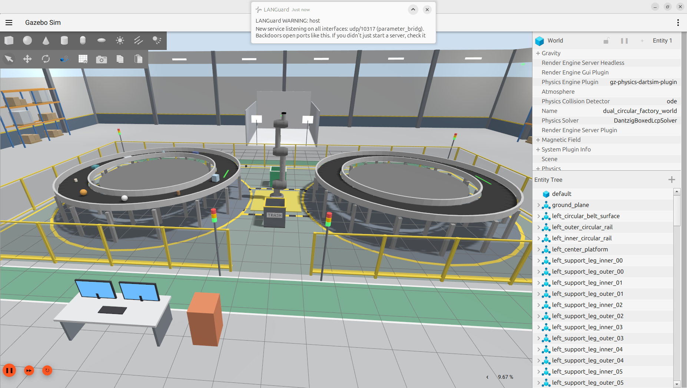

*A 7-axis **Black Coffee Robotics (BCR) arm** watches moving products through three cameras. It picks each product off
one conveyor ("bent") and places it on another bent, or drops it into a trash or recycling bin.
Every decision comes from **OpenCV**.*

🌐 **[Project website](https://huseyintozluyurt.github.io/Factory-Bent-Simulation-with-BCR-Robot-Arm/)** · [Quick start](#-quick-start) · [Features](#-features) · [Architecture](#-architecture) · [Worlds](#-worlds) ·
[Vision](#-vision-pipeline) · [Vision lab](#-vision-lab) · [Commands](COMMANDS.md) · [Reports](docs/reports/)

</div>

---

## ✨ Features

| | Feature | What you get |
|---|---|---|
| 👁️ | **Three-camera OpenCV vision** | An overhead camera that detects and tracks products, a side camera that cross-checks them and measures height, and a release camera that checks the drop zone |
| 🦾 | **Closed-loop pick and place** | URDF-based IK, catching moving products, holding the product while gripping, a precise grasp, and 6 movement styles |
| ♻️ | **Sorting into bins** | A trash bin and a recycling bin, a destination for each product type, and auto-sort by material |
| 📦 | **Product generator** | 100 realistic product types, your own `.stl`, `.obj` or `.dae` models, and orders spawned on any bent |
| 🖥️ | **Order GUI** | A PyQt5 window for orders, destinations, belt speed and simulation speed, run time, and the arm movement style |
| 🌍 | **10 worlds** | Circular and straight bents in every combination, plus a factory with 13 conveyors and 12 arms |
| 🧪 | **Vision lab** | Plug-in OpenCV or YOLO detectors, 10 example labs, scoring without Gazebo, auto-labelled YOLO datasets, and pipeline tests |
| 🚀 | **One-command start** | `./run_factory.sh` starts everything: order window, Gazebo, arm, cameras and controller |

<table>
<tr>
<td width="50%">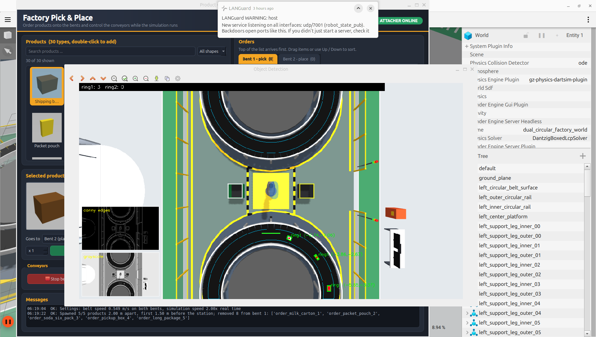<br/><sub><b>Order GUI and live detection</b> in the dual circular world</sub></td>
<td width="50%">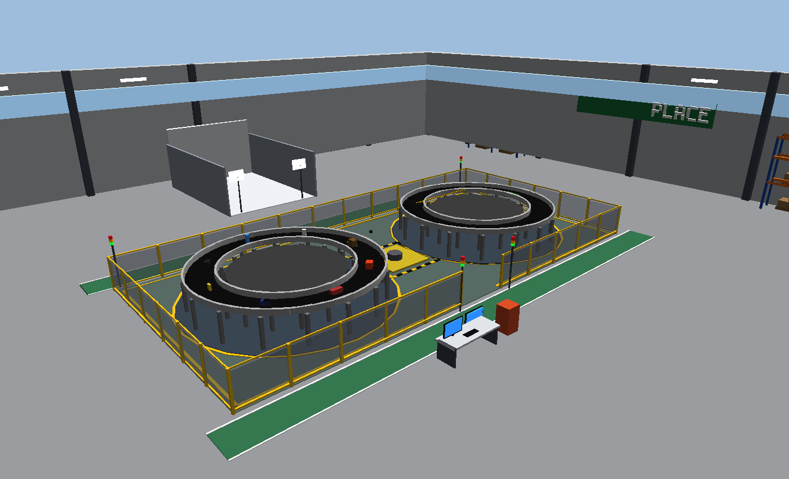<br/><sub><b>Dual circular factory</b> with the trash and recycling bins</sub></td>
</tr>
</table>

---

## 🚀 Quick start

### 1. Requirements

| Item | Version or package |
|---|---|
| OS | Ubuntu 24.04 |
| ROS 2 | Jazzy (`ros-jazzy-desktop`, `ros-jazzy-ros-gz`, `ros-jazzy-ros2-control`, `ros-jazzy-joint-trajectory-controller`) |
| Gazebo | Harmonic |
| BCR arm | `bcr_arm_description`, `bcr_arm_gazebo` and the other BCR arm packages in `~/ros2_ws/src` |
| Python | `python3-opencv`, `python3-pyqt5`, `python3-gz-transport13`, `python3-gz-msgs10` |
| Optional | `pip install ultralytics` (YOLO detectors) |

```bash
sudo apt install python3-opencv python3-pyqt5 python3-gz-transport13 python3-gz-msgs10
```

### 2. Get the code and build

```bash
mkdir -p ~/ros2_ws/src && cd ~/ros2_ws/src
git clone https://github.com/huseyinTozluyurt/Factory-Bent-Simulation-with-BCR-Robot-Arm.git factory_bent_project
# put the BCR arm packages in ~/ros2_ws/src as well

cd ~/ros2_ws
rosdep install --from-paths src --ignore-src -r -y
colcon build --symlink-install
chmod +x src/factory_bent_project/*.sh
```

### 3. Set up each terminal

```bash
export GZ_VERSION=harmonic
source /opt/ros/jazzy/setup.bash
source ~/ros2_ws/install/setup.bash
```

> 💡 Optional shortcut: `echo 'alias fb="export GZ_VERSION=harmonic && source /opt/ros/jazzy/setup.bash && source ~/ros2_ws/install/setup.bash && cd ~/ros2_ws"' >> ~/.bashrc`, then type `fb` in each new terminal.

### 4. Run

```bash
cd ~/ros2_ws/src/factory_bent_project
./run_factory.sh
```

1. The **Product Order** window opens. Pick products, set "Goes to" (bent 2, trash or recycling) and the spacing, then press **Start simulation with this order**.
2. Gazebo starts with both bents, the arm, the cameras, the attacher and the controller.
3. Your products appear on bent 1 and the arm starts picking them. After about 8 s, the order window opens again for live orders.
4. Press **Ctrl+C** in the terminal to stop everything.

| Variant | Command |
|---|---|
| Reuse the last order | `./run_factory.sh --no-select` |
| The world's own products, no order window | `./run_factory.sh --world-products` |
| Build first | `./run_factory.sh --build` |
| Another world | `./run_factory.sh --world straight-circular` |
| Different movement style | `./run_factory.sh motion_type:=cycle` |
| No OpenCV windows | `./run_factory.sh show_window:=false` |

Every command, including the four-terminal manual start, is in **[COMMANDS.md](COMMANDS.md)**.

---

## 🧭 Architecture

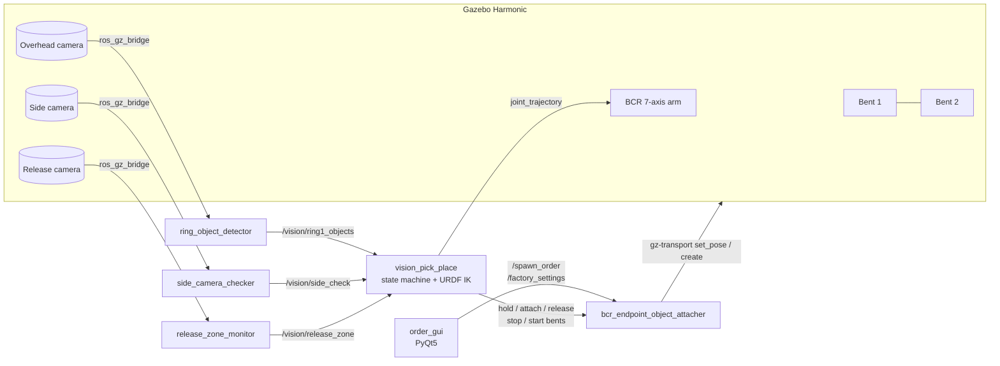

### One pick-and-place cycle

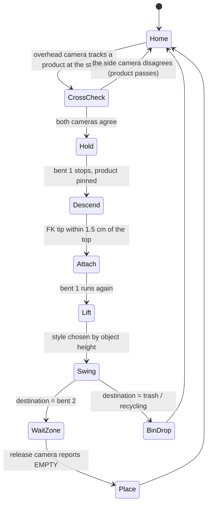

| Node | Role |
|---|---|
| `ring_object_detector` | Overhead OpenCV: grayscale, blur, threshold or Canny, contours in each belt lane, `minAreaRect`, pixel to world; the arm is masked out using TF |
| `side_camera_checker` | MOG2 background subtraction and Canny; finds products standing on the belt at the station and measures their height |
| `release_zone_monitor` | Compares each frame with a learned empty belt and reports whether the drop zone on bent 2 is empty |
| `vision_pick_place` | Runs the cycle: cross-check, URDF IK (damped least squares), movement styles, destinations |
| `bcr_endpoint_object_attacher` | Grasp and release, holding the product still, stopping and starting bents, spawning orders, simulated falls into bins and boxes |
| `order_gui` | Orders, destinations, belt speed, simulation speed and run time, arm movement style, product pictures and custom products |

---

## 🌍 Worlds

All single-cell worlds are generated from one layout. The arm, catch station `(-2.58, 0)`, place point `(2.22, -0.37)`, cameras and bins are in the same place in every world. Only the belts change.

| Launcher | Bent 1 | Bent 2 | The arm delivers to |
|---|---|---|---|
| `./run_dual_circular.sh` | ⭕ circular | ⭕ circular | bent 2, trash, recycling |
| `./run_single_circular.sh` | ⭕ circular | none | trash and recycling (the rest stay on the belt) |
| `./run_straight_conveyor.sh` | ➖ straight | none | trash and recycling (the rest fall into a collection box) |
| `./run_exp_straight_to_circular.sh` | ➖ straight | ⭕ circular | bent 2, trash, recycling |
| `./run_exp_circular_to_straight.sh` | ⭕ circular | ➖ straight | bent 2, trash, recycling |
| `./run_exp_straight_to_straight.sh` | ➖ straight | ➖ straight | bent 2, trash, recycling |
| `./run_pipeline_factory.sh` | 4 rings and 9 lines | | 12 arms and 5 docks |

<table>
<tr>
<td>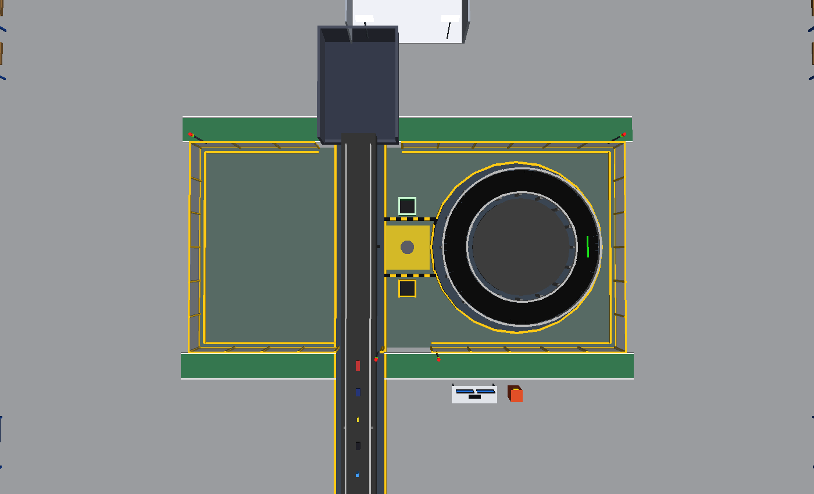<br/><sub>Straight → circular</sub></td>
<td>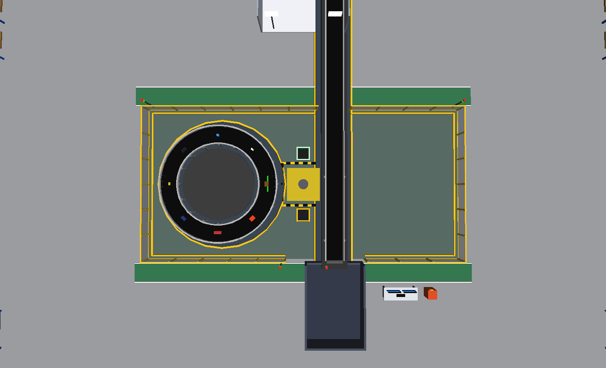<br/><sub>Circular → straight</sub></td>
<td>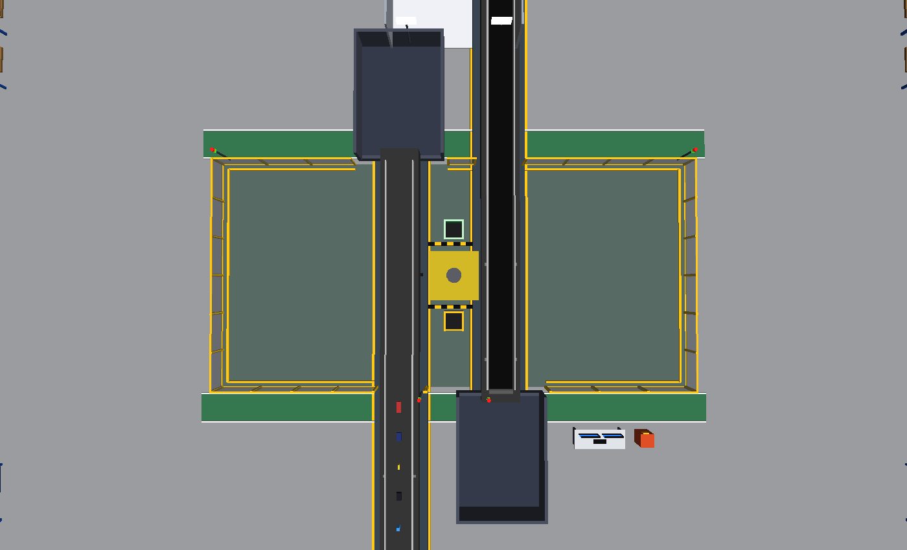<br/><sub>Straight → straight</sub></td>
</tr>
</table>

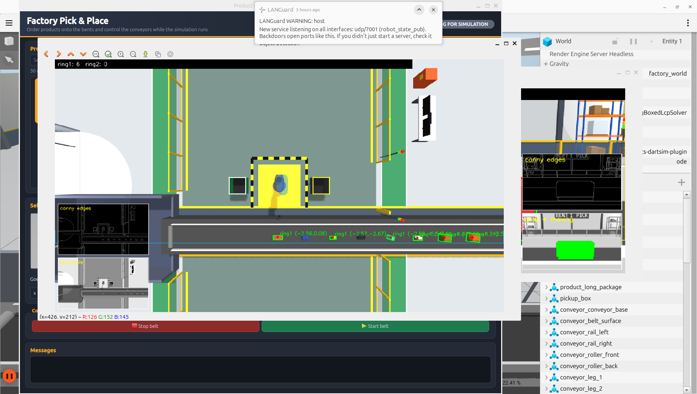

> 🐢 Is Gazebo slow? Start with `dual_circular_factory_conveyor_plain.sdf`, which has no decor:
> `./run_factory.sh factory_world_path:=$HOME/ros2_ws/src/factory_bent_project/my_factory_worlds/worlds/dual_circular_factory_conveyor_plain.sdf`

---

## 👁️ Vision pipeline

| Camera | OpenCV steps | Question it answers |
|---|---|---|
| **Overhead** (13 m above, looking straight down) | grayscale → blur → threshold or filled Canny → morphology → contours in each belt lane → `minAreaRect` → pixel ray meets the plane of the product's top | *Where is each product, and when will it reach the arm?* |
| **Side** (at belt height, facing the station) | MOG2 → Canny → contours whose bottom is on the belt | *Is it really standing on the belt, and how tall is it?* |
| **Release** (above bent 2) | difference from the learned empty belt → threshold → contours in the zone | *Is the drop zone free?* |

The arm only grabs a product when the overhead track and the side-camera blob agree within **0.20 m**. If they disagree, the product rides on.

<table>
<tr>
<td>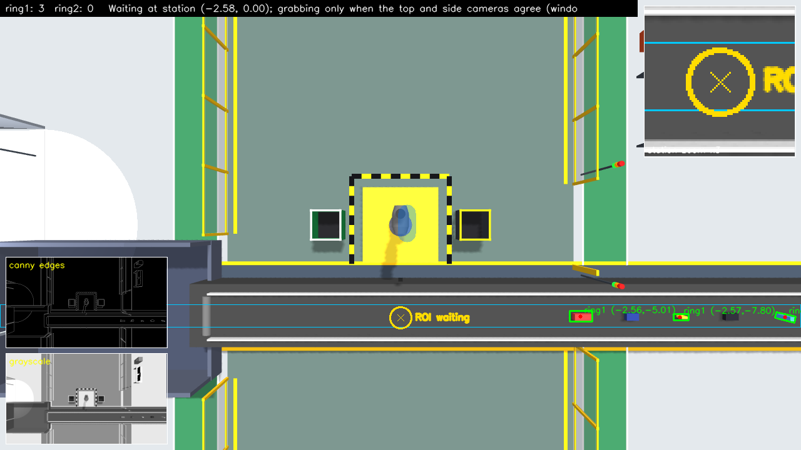<br/><sub>Overhead detections</sub></td>
<td>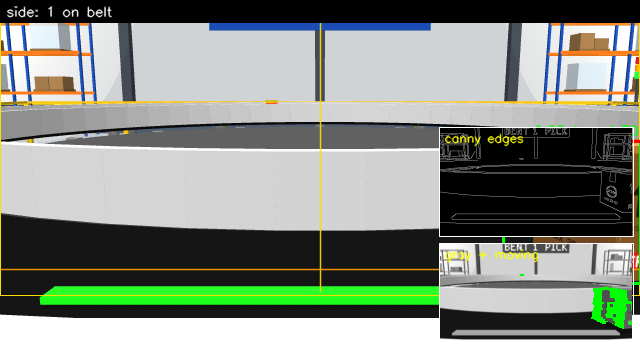<br/><sub>Side camera cross-check</sub></td>
<td>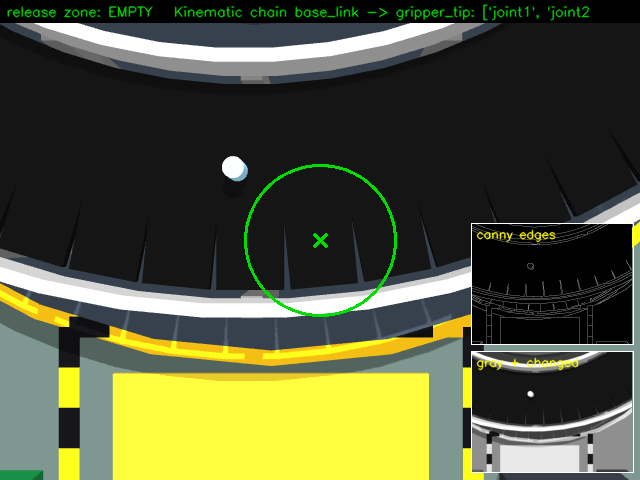<br/><sub>Release zone (green = empty)</sub></td>
</tr>
</table>

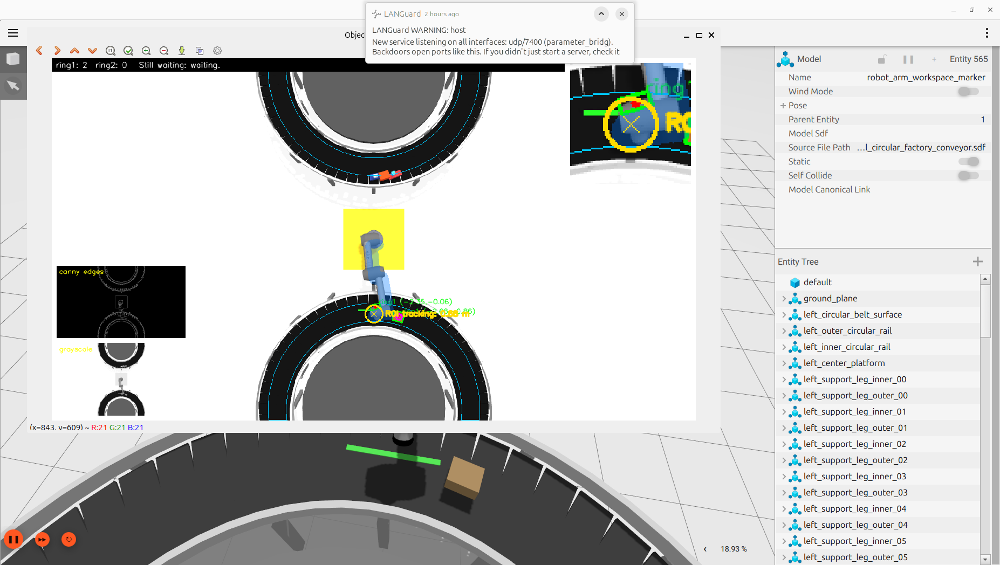

The vision geometry modules (`vision_geometry.py`, `side_vision.py`, `release_zone.py`) don't import ROS, so you can test them offline on synthetic images.

---

## 🦾 Pick and place

- **IK:** `urdf_ik.py` reads the chain from `/robot_description` and solves for the gripper tip position with damped least squares. It pulls each solution toward a taught pose, and it rejects postures that would hit a bin wall.
- **Grasp:** the arm descends quickly to 10 cm above the product, then slowly. It grips only once forward kinematics puts the tip within 1.5 cm of the product's top. The held product stays pinned in place, so the gripper can't push it.
- **Movement styles** (`motion_type`):

| Style | Lift | Swing | When `auto` uses it |
|---|---|---|---|
| `standard` / `mirror` | 0.50 m | 3.0 s, left / right | medium-height objects, taking turns |
| `high_carry` | 0.60 m | 4.0 s | tall objects (≥ 0.30 m), to clear ring 1 |
| `low_fast` | 0.30 m | 2.5 s | flat objects (≤ 0.15 m), for the shortest cycle |
| `full_turn` / `reverse_return` | 0.45 m | 3.0 / 3.5 s | medium-height objects, taking turns |

- **Bins:** RECYCLE (green) is at `(0, +2.2)` and TRASH (grey) at `(0, −2.2)`. The arm travels high over the bin centre and drops the product, and its fall into the bin is simulated.

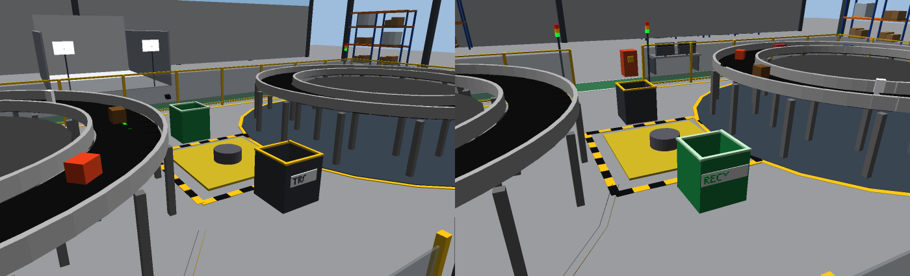

---

## 📦 Product generator

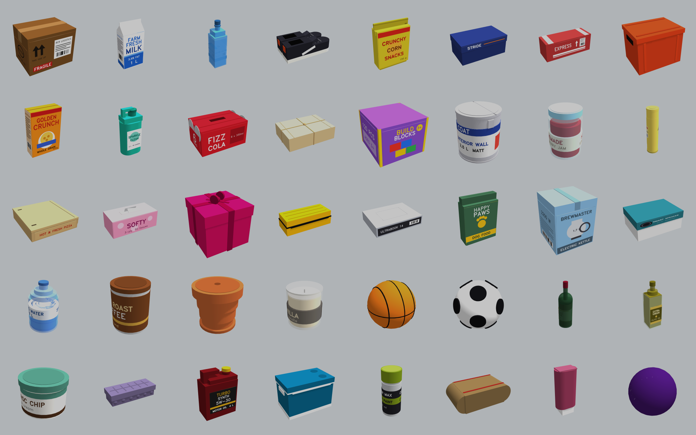

- **100 built-in types:** 66 boxes, 26 cylinders and 8 spheres. Each has a detailed look (caps, lids, ribbons, printed labels with fictional brands) but a simple collision shape. The top keeps the catalogue colour, so the detectors still recognise each type.
- **Your own products:** in the GUI, use **Add your own product…**, or run `python3 -m factory_bringup.custom_products add --name coffee_mug --mesh ~/mug.stl --size 0.12 0.09 0.10`. You can share a product as a `.zip`.
- **Spawn from a terminal:**

```bash
ros2 topic pub --once /spawn_order std_msgs/msg/String \
  "{data: '{\"bent\": 1, \"items\": [\"paint_can\", \"cereal_box\"], \"spacing\": 1.0, \"start_offset\": 1.5, \"clear\": true}'}"
```

<table>
<tr>
<td width="60%">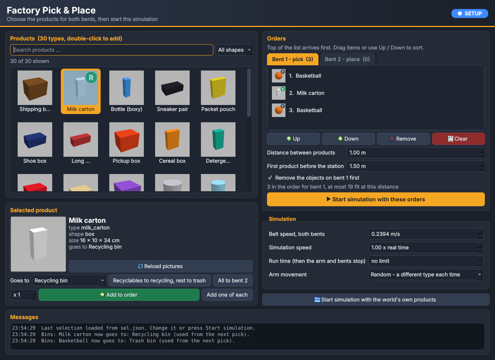<br/><sub>Order GUI: search, drag-to-sort, "Goes to" badges, simulation settings</sub></td>
<td width="40%">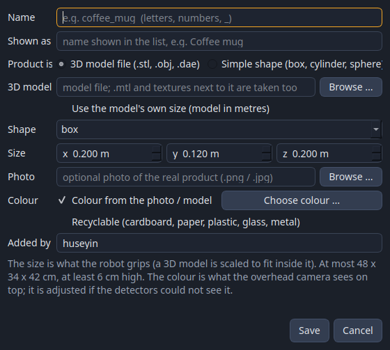<br/><sub>Add your own product from a 3D model or a photo</sub></td>
</tr>
</table>

---

## 🧪 Vision lab

You write a detector and one `main(lab)` function. The lab connects them to the arm, the belts and the bins in any world.

```python
# labs/lab_my_sorter.py
DETECTOR = "opencv_color"        # opencv_contours | opencv_color | opencv_bgsub | yolo | your Detector class

def main(lab):
    lab.run({"glass_jar": "recycling", "pizza_box": "trash", "*": "bent2"}, count=10)
    print(lab.report())          # where each product went, and whether the label was right
```

```bash
./run_vision_lab.sh sim --world dual                    # terminal 1: the simulation
./run_vision_lab.sh run my_sorter                       # terminal 2: your lab
./run_vision_lab.sh offline --synthetic 20 --world all  # score detectors without Gazebo
./run_vision_lab.sh run 10_pipeline_tests --fake        # pipeline test cases, no Gazebo
```

| Lab | Experiment | Lab | Experiment |
|---|---|---|---|
| 01 | detection survey | 06 | YOLO sorting |
| 02 | bent → bent | 07 | record an auto-labelled YOLO dataset |
| 03 | trash and recycling | 08 | all 12 pipeline stations sort by vision |
| 04 | sort by label | 09 | pipeline demo in 3 acts |
| 05 | your own OpenCV detector | 10 | pipeline tests (PASS/FAIL for each product) |

The latest logged pipeline test run passed **7 of 7 cases**, with the detector's labels correct in **80 %** of decisions. Most misses were `shoe_box` labelled as `cookie_tin`.
The full API is in [vision_lab/README.md](factory_bringup/factory_bringup/vision_lab/README.md) and [labs/README.md](labs/README.md).

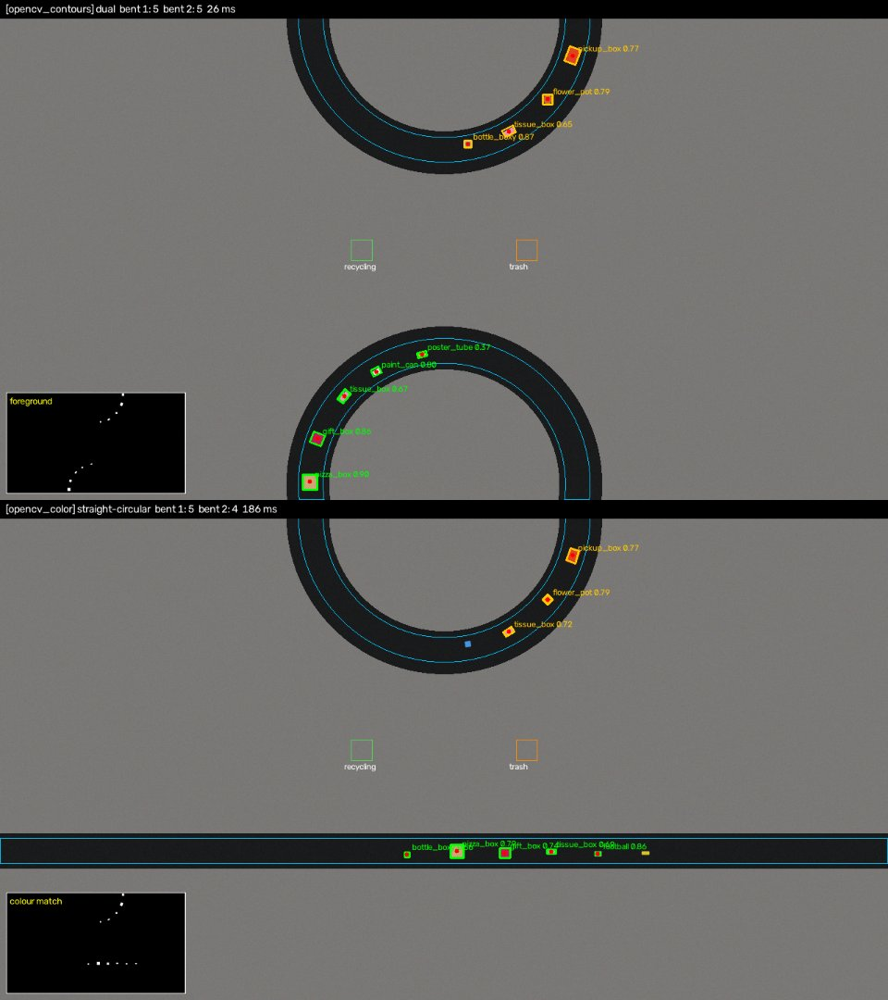

---

## ⚙️ Configuration cheatsheet

| Parameter (node) | Default | Effect |
|---|---|---|
| `motion_type` (`vision_pick_place`) | `auto` | movement style: `auto`, `cycle`, `random`, or a style name |
| `wait_at` | `home` | where the arm waits between catches (`home` or `station`) |
| `use_side_camera` / `use_release_camera` | `true` | turn the cross-check or the zone check on and off |
| `use_bins` | `true` | allow trash and recycling destinations |
| `cross_check_tol` | `0.20` m | how closely the overhead and side cameras must agree |
| `descend_gap` | `0.01` m | how far above the product's top the gripper stops |
| `bin_travel_z` | `2.1` m | tip height while travelling to a bin |
| `dry_run` | `false` | detect and solve IK without moving the arm |
| `pin_held_object` (attacher) | `true` | keep the product still while the gripper comes down |
| `belt_speed` (via `/factory_settings`) | `0.2394` m/s | one speed for both bents |
| `vision_delay` (launch) | `8.0` s | wait for Gazebo before starting the cameras and controller |
| `FACTORY_WORLD_NAME` (env) | from the SDF | selects the belt layout in `WORLD_LAYOUTS` |

<details>
<summary><b>ROS services and topics</b></summary>

| Kind | Name | Purpose |
|---|---|---|
| service | `/vision_pick_place/start`, `/stop` | run or stop the controller |
| service | `/hold_object_for_pick`, `/resume_held_object` | stop the product at the station, or let it go |
| service | `/attach_object_to_endpoint`, `/release_object_from_endpoint` | grasp and release |
| service | `/stop_bent1`, `/start_bent1`, `/stop_bent2`, `/start_bent2` | stop and start each belt |
| service | `/release_zone_monitor/relearn` | learn the empty drop zone again |
| topic | `/spawn_order` → `/spawn_order/result` | put an order on a bent (JSON) |
| topic | `/factory_settings` | belt speed, real-time factor, run minutes (JSON) |
| topic | `/vision/detections`, `/vision/ring1_objects`, `/vision/side_check`, `/vision/release_zone` | vision results |
| topic | `/vision_pick_place/status`, `/vision_pick_place/cross_check` | controller state, and why it isn't grabbing yet |

</details>

---

## 🌐 Project website

A React + Vite site explains the whole project with images and interactive diagrams, including the
**12-arm pipeline factory**: **[https://huseyintozluyurt.github.io/Factory-Bent-Simulation-with-BCR-Robot-Arm/](https://huseyintozluyurt.github.io/Factory-Bent-Simulation-with-BCR-Robot-Arm/)**

It is published to GitHub Pages automatically by `.github/workflows/deploy-pages.yml` on every push to `main`.
To run it locally (Node.js 20.19 or newer):

```bash
cd website
npm install
npm run dev
```

---

## 📁 Repository layout

```
factory_bent_project/
├── run_factory.sh, run_*.sh            one-command launchers (one per world)
├── run_vision_lab.sh, vision_lab_main.py
├── COMMANDS.md                          full command reference
├── docs/images/, docs/reports/          README images and PDF project reports
├── website/                             React + Vite project website (GitHub Pages)
├── labs/                                lab_01 … lab_10 experiments
├── my_factory_worlds/
│   ├── worlds/                          10 .sdf worlds
│   └── tools/                           world generators
└── factory_bringup/                     ROS 2 package (ament_python)
    ├── launch/                          factory_full, vision_pick_place, attacher, arm UI
    └── factory_bringup/
        ├── vision_pick_place.py         controller
        ├── bcr_endpoint_object_attacher.py
        ├── ring_object_detector.py, side_camera_checker.py, release_zone_monitor.py
        ├── vision_geometry.py, side_vision.py, release_zone.py, urdf_ik.py
        ├── order_gui.py, product_catalog.py, product_models.py, custom_products.py
        └── vision_lab/                  lab framework, detectors, pipeline sim and tests
```

---

## 📜 Project history

The project started in **March 2026** as a single straight conveyor with an overhead camera. Between **Oct 29 and Nov 1, 2026**, it grew into the full system through about 27 phases, which you can trace through the `.bak_before_*` backups.

| March 2026: the start | November 2026: the dual circular factory |
|---|---|
| 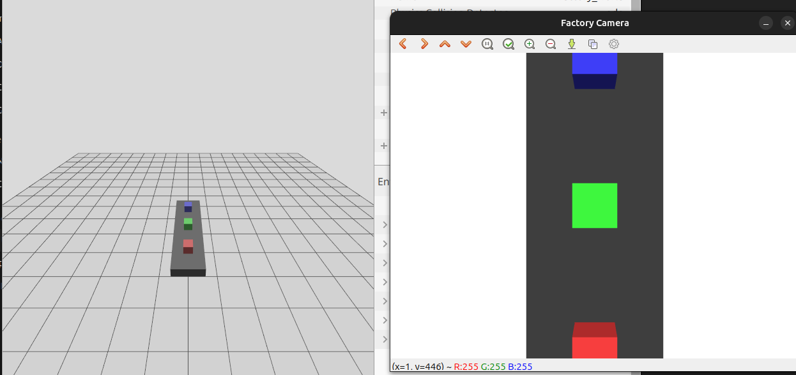 |  |

| 📄 Report | Contents |
|---|---|
| [01 Project Overview](docs/reports/01_Project_Overview.pdf) | goals, architecture, worlds, how to run |
| [02 Evolution Timeline](docs/reports/02_Evolution_Timeline.pdf) | every phase with its date and reason |
| [03 Vision Pipeline](docs/reports/03_Vision_Pipeline_Evolution.pdf) | from threshold scripts to cross-checked cameras |
| [04 Robot Arm Pick & Place](docs/reports/04_Robot_Arm_Pick_and_Place_Evolution.pdf) | attacher, IK, grasp, movement styles, bins |
| [05 Worlds & Product Generator](docs/reports/05_Worlds_and_Product_Generator_Evolution.pdf) | from 1 belt to 13, from 7 products to 100+ |
| [06 Vision Lab & Testing](docs/reports/06_Vision_Lab_and_Testing.pdf) | lab API, demo, pipeline test results |

---

## 🛠️ Troubleshooting

<details>
<summary><b>The Gazebo window doesn't appear</b></summary>

Allow multicast:

```bash
sudo ufw allow in proto udp to 224.0.0.0/4
sudo ufw allow in proto udp from 224.0.0.0/4
```
</details>

<details>
<summary><b>The product lags behind the gripper, or attaching is slow</b></summary>

Check that the gz-transport Python bindings are installed:
`python3 -c "from gz.transport13 import Node"`. If the import fails, run `sudo apt install python3-gz-transport13 python3-gz-msgs10`.
</details>

<details>
<summary><b>The arm doesn't grab anything</b></summary>

Run `ros2 topic echo /vision_pick_place/cross_check` to see why it is waiting.
Run `ros2 topic hz /side_camera/image` to check that the side camera is bridged (about 15 Hz).
If Gazebo loads slowly, start with `vision_delay:=12`.
</details>

<details>
<summary><b>Products hang in the air past the end of a straight belt</b></summary>

The attacher node moves products into the collection box. Check that it is still running, and look for "fell off the end of bent 1" in its log.
</details>

<details>
<summary><b>Nodes from an earlier run are still around</b></summary>

```bash
pkill -f "gz sim"; pkill -f parameter_bridge; ros2 daemon stop && ros2 daemon start
```
</details>

---

## 🗺️ Roadmap

- [x] Vision-driven pick and place between two bents
- [x] Side-camera and release-camera checks
- [x] Trash and recycling bins, and sorting by material
- [x] Six single-cell worlds and the 12-arm pipeline factory
- [x] Vision lab with OpenCV and YOLO detectors
- [x] 100 realistic products and custom 3D products
- [ ] Test every world and the pipeline lab in Gazebo on hardware
- [ ] Train a YOLO model on a lab 07 dataset and compare it with the OpenCV detectors
- [ ] Run the whole pipeline factory with ROS controllers

---

<div align="center">

Developed by **Hüseyin Tozluyurt** · ROS 2 Jazzy · Gazebo Harmonic · OpenCV

</div>
